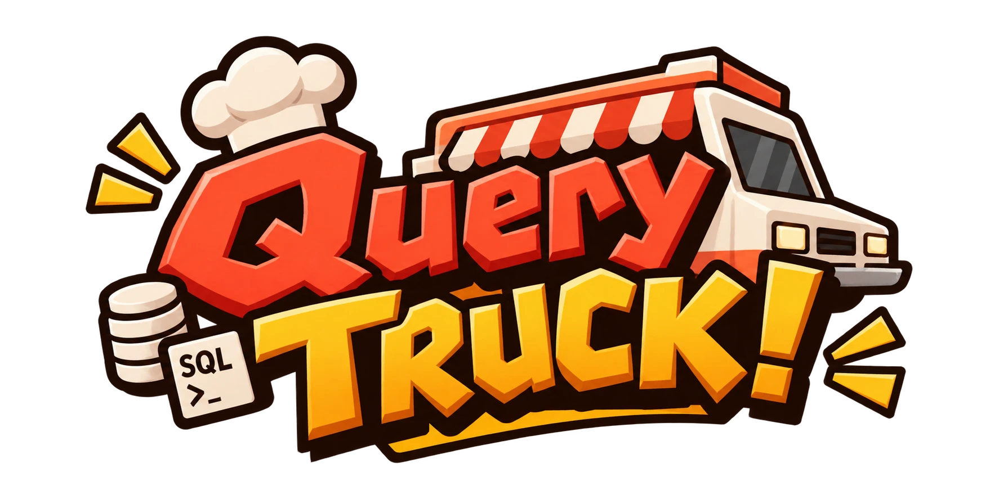
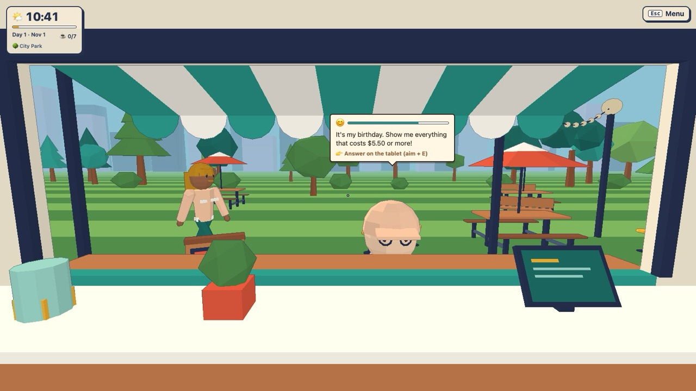
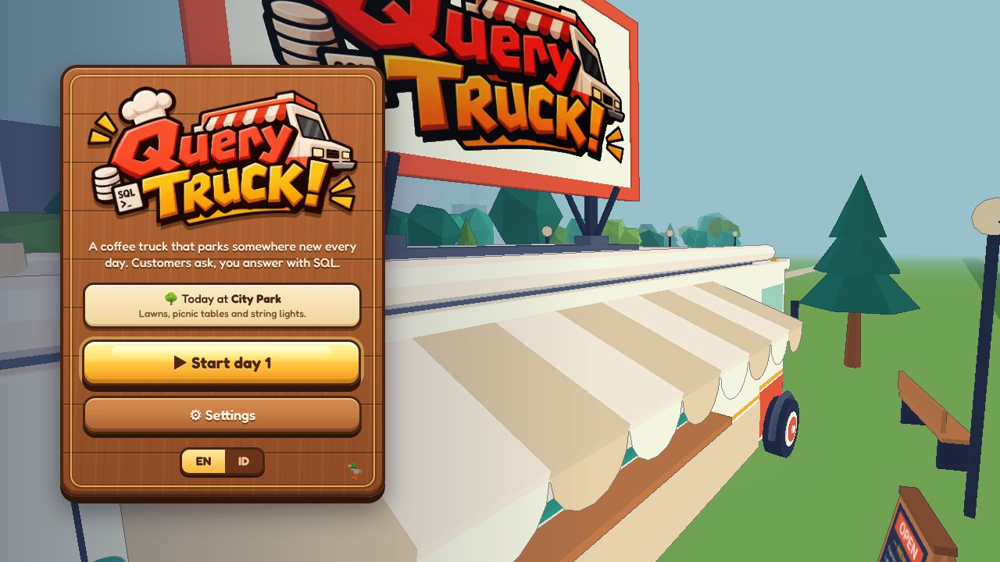
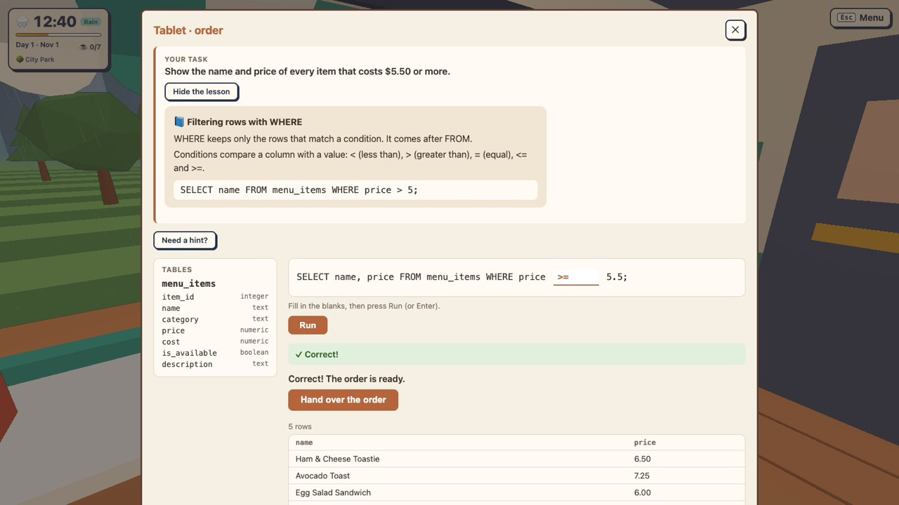
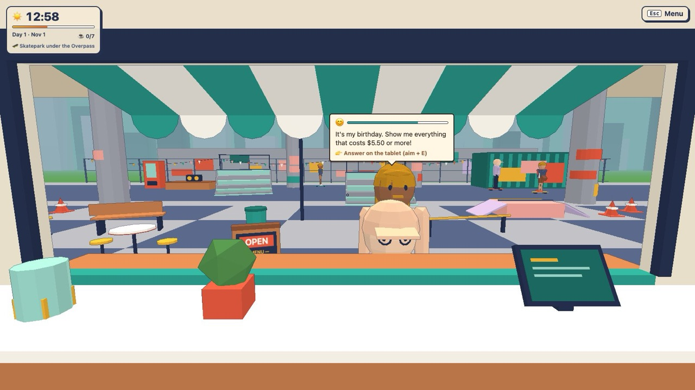
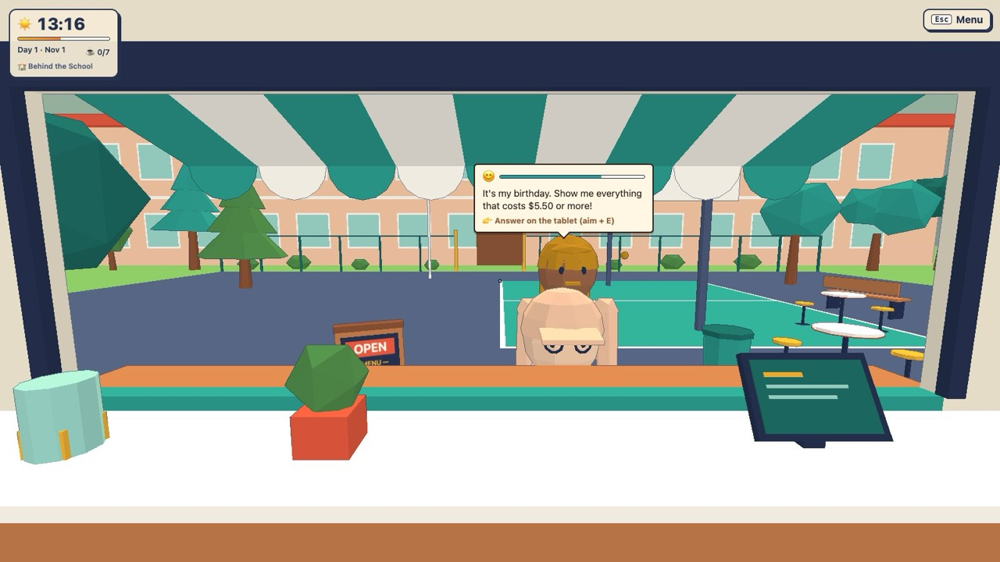
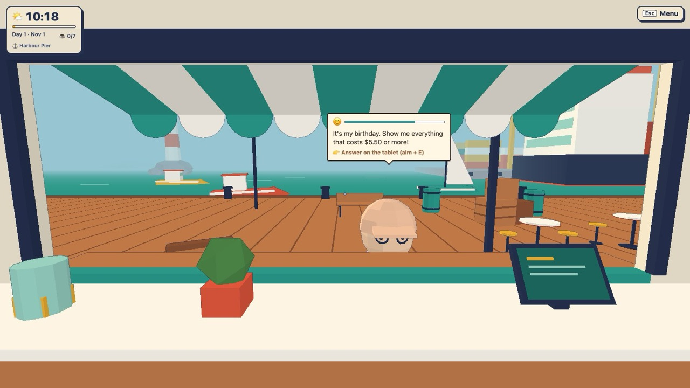
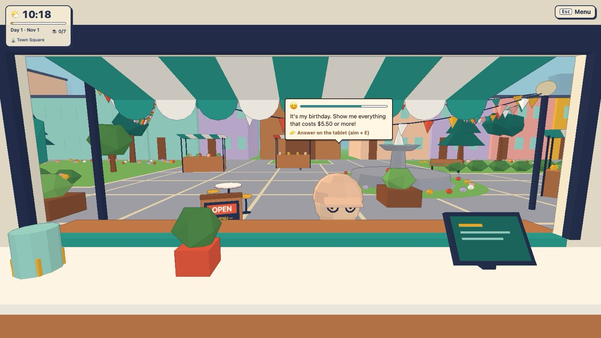
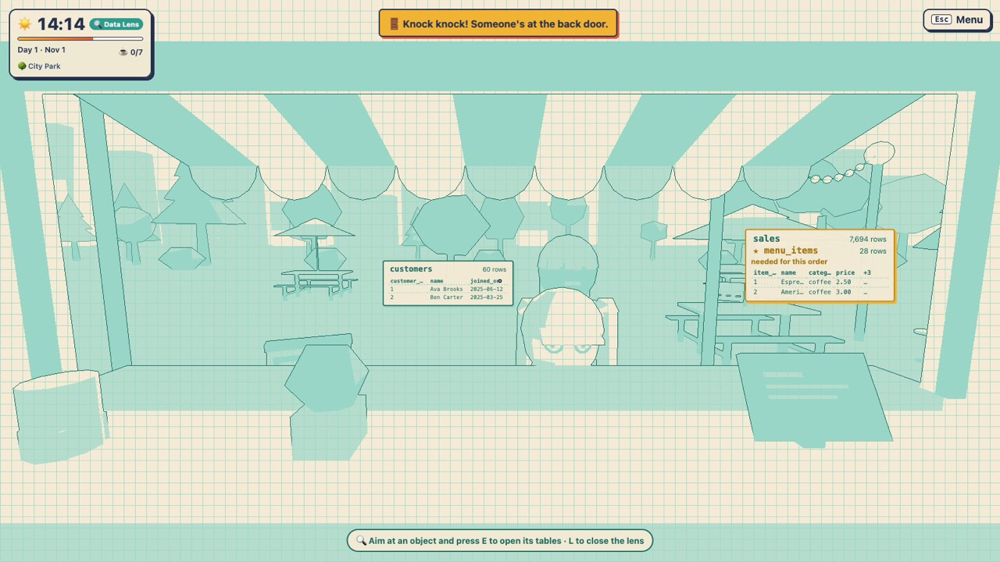

<p align="center"></p>

# Query Truck

A first-person 3D game for learning SQL: you run a food truck that parks somewhere new in the city every day, and every customer at the window brings a request you answer with SQL. Built around **thinking like a Business Intelligence (BI) analyst**, in a clean low-poly look.

**▶ Play it in the browser: <https://neinstat.github.io/query-truck-game/>** (the latest `main`; a work in progress)



<p align="center">
  
  
  
  
  
</p>

## Why this project exists

- **SQLBolt** is interactive and easy to follow, but every lesson is the same exercise format, with nothing that feels like a game. It also stops around early intermediate level, so it never reaches real Business Intelligence (BI) cases.
- **LeetCode** has excellent case studies, but working through them doesn't feel interactive, and they are hard to follow when you are just starting out.

Query Truck takes the best of both: a gentle, step-by-step path like SQLBolt, wrapped in a game that makes you want to keep going, and building up to case studies like LeetCode's, all the way to the skill real data jobs need: **answering business questions with data**.

## The concept

You are the new hire at **Query Truck**, a coffee food truck that parks somewhere new every day: the city park, a skatepark under the overpass, behind the school, the harbour pier, the town square. Customers walk up and queue at your window, sometimes in the rain. Each one asks for something ("what can I get for under $3?", "which coffees can I actually order today?"), and you answer by writing SQL on the truck's tablet. Later, **The Manager** in a suit knocks on the back door with harder questions: sales this month, what keeps selling out, why revenue dropped.

- Runs entirely in the browser: real **PostgreSQL** via PGlite, no backend
- From `SELECT` to `JOIN`s, aggregation and real analysis cases
- Questions come back on later days, so you practise until queries stick
- Play in **English** or **Bahasa Indonesia** (SQL, table names and data always stay in English)

## How to play

1. Click the screen to look around (**Esc** frees the mouse).
2. **WASD** or the arrow keys to walk around the truck, the **mouse** to look.
3. Aim the crosshair at something and press **E** (or click). Each object sees its own tables: the **tablet** (sales, customers, menu), the **fridge** (stock, suppliers), the **menu board** and the **recipe binders**. The speech bubble tells you where to answer each order; any other object lets you look around its data freely.
4. Press **L** (or 🔍 Data Lens) to see the data behind everything: the truck turns into a blueprint and every object shows its tables, with the ones the current order needs starred. Click a table on a card to open it.
5. Read the customer's request, write SQL, press **Run** (or Ctrl/⌘ + Enter). Your *result* is graded, not your text, with specific feedback when it isn't right yet.
6. **Hand over the order**, and the next customer steps up. Every order you serve becomes real rows in the `sales` table (`channel = 'truck'`), so you can query your own day.
7. Watch the clock: the truck opens 10:00–17:00. Time stops while a console is open and speeds up when nobody is waiting. Customers get impatient (😊 → 😐 → 😠) and tip less, or leave. At closing time you get a summary of the day, with the SQL that counted your revenue.

## Screenshots

| Title screen | The SQL tablet |
|---|---|
|  |  |

### A new place every day

The truck parks somewhere different each day, each with its own scenery, crowd and weather.

| Skatepark under the Overpass | Behind the School |
|---|---|
|  |  |
| **Harbour Pier** | **Town Square** |
|  |  |

## The look

The world is **low-poly**: flat-shaded shapes in a small palette with a thin ink outline, and the sky goes from morning to night over each working day. The models are simple placeholders for now (see [docs/ASSETS.md](docs/ASSETS.md)).

**The Data Lens** turns the same picture into a teal blueprint: the world dissolves pixel by pixel, and a card floats over every object with its tables, row counts and sample rows.



## Status

🚧 **Phase 5: order generator & repetition.** The one-day prototype (Phase 4) is done. Orders now come from templates, each SQL concept has a mastery level with spaced repetition, the input grows with mastery, and days follow one another. The game has a title screen, a days screen with practice runs, an Esc pause menu, a staff handbook, five places, rain and a truck radio.

The SQL core is complete from the first version of the game: 34 levels in six chapters (from `SELECT` to an analysis case), Mini Cases, a Skill Check and a timed mode. Phase 6 turns them into customer orders and manager questions over six in-game weeks.

- [GAME_DESIGN.md](GAME_DESIGN.md): the full design and roadmap
- [docs/AUTOMATION.md](docs/AUTOMATION.md): how the game is built — a nightly agent opens pull requests with playable previews, the owner reviews
- [docs/JOURNEY.md](docs/JOURNEY.md): how the game went from a top-down 2D café to a 3D food truck, with screenshots

## Getting started

Requires Node.js 22+.

```bash
npm install
npm run dev        # start the dev server at http://localhost:5173
npm test           # run the tests
npm run build      # typecheck and build for production
npm run preview    # serve the production build at http://localhost:4173
```

## Tech stack

| Part | Choice |
|---|---|
| 3D world | [Three.js](https://threejs.org/) with a small outline post-processing pass (about 130 KB gzipped, loaded on demand) |
| SQL tablet and overlays | React 19 + [CodeMirror 6](https://codemirror.net/) (SQL highlighting and autocomplete) |
| Database | [PGlite](https://pglite.dev/): real PostgreSQL in the browser, running in a Web Worker so a slow query can be stopped |
| Language and tooling | TypeScript, Vite, Vitest |

How answers are kept safe and fair:

- Every query runs in a **read-only transaction** that is always rolled back, so the data can never be changed.
- Each part of the truck runs as its own **PostgreSQL role** that may only read its own tables.
- The checker compares **results**, not query text: any correct way of writing it counts. Row order only matters when the task asks for it.

## Project structure

```
src/
├── sql-core/      # the SQL "brain": no UI or game-engine code allowed here
│   ├── db.ts        # PGlite database, roles and the safe, read-only query runner
│   ├── stations.ts  # which tables each console can see
│   ├── checker.ts   # compares the player's result with the solution
│   ├── cases.ts     # case conclusions and evidence
│   ├── skillCheck.ts, rushHour.ts
│   ├── feedback.ts  # feedback messages in English and Indonesian
│   ├── data/        # the truck's data: menu, generated sales, recipes, stock (seeded, always the same)
│   ├── levels/      # chapters, levels and their translations (locales/id)
│   └── truck/       # customer orders (locales/id for translations)
├── console/       # SQL console UI (React): blocks, fill-in-the-blank, editor, case notes
├── game/          # the 3D world (Three.js): no React code allowed here
│   ├── art/riso.ts  # the colour palette
│   └── truck/       # world layout, models, outline pass, sky, queue, the game loop, and the bridge to React
├── app/           # the page around the world: HUD, tablet, the shift's logic, the database worker
└── i18n.ts        # UI text in both languages
docs/
├── JOURNEY.md     # the design journey, with screenshots
├── ASSETS.md      # which art is final and which is a placeholder
├── AUTOMATION.md  # CI, pull request previews and the nightly agent
├── screenshots/   # the current game, used in this README
└── journey/       # screenshots of earlier versions
```

## Credits

No third-party art is used yet: the palette, models and shader are original. See [CREDITS.md](CREDITS.md).
